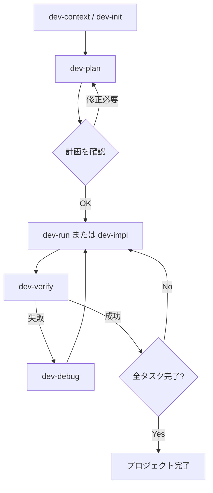

# Enso マニュアル

Enso の全スキルの詳細マニュアルです。インストール方法と、**スキル一覧（人が呼ぶスキル / 内部スキル）の正本は [README.md](./README.md#スキル一覧)** にあります。本ファイルは各スキルの詳細解説のみを扱い、一覧表は持ちません。

## セットアップ

### 強制モード

プロジェクトごとに、enso のスキル経由と worktree/PR 運用を**強制**できます。既定では無効で、設定ファイルが無いプロジェクトの挙動は一切変わりません。

#### 有効化

```bash
/enso:enso-policy init      # 対話で設定を作り、追跡下に置いて PR にする
/enso:enso-policy show      # 現在の設定と、いま何がブロックされるかを確認
/enso:enso-policy disable   # 設定を残したまま一時的に無効化
/enso:enso-policy enable    # 再度有効化
```

`<project>/.claude/enso.json` が作られます。**設定の反映には Claude Code の再起動が必要です**（hooks はセッション開始時に読み込まれるため）。

`init` は設定ファイルを git の追跡下に置き、**PR まで作成します**。マージして再起動するまでは反映されません。git リポジトリでない場合やリモートが無い場合は、到達できたところ（ファイル生成のみ／コミットまで）で止まり、残りの手順が案内されます。

`show` / `enable` / `disable` は PR を作りません。`enable` / `disable` は追跡下のファイルを書き換えるため、作業ツリーに差分が出ます。**その差分をうっかりコミットするとチーム全員の設定が変わる**ので注意してください。

#### 何が起きるか

有効なプロジェクトでは、enso プラグインの hooks が次のように働きます。

| タイミング | 動作 |
|---|---|
| ユーザーの発話ごと | 経由すべきスキル・現在のブランチ・`loop-state.yaml` の状況・次にすべきことがコンテキストに注入される（完了済みの計画は件数のみ） |
| ファイル変更（Edit/Write/NotebookEdit） | worktree の外、または保護ブランチ上ならブロックされる |
| `git commit` / `git push` / `gh pr create` | 同上 |
| `gh pr ready` | この PR の計画の `reports/` にセキュリティチェックのレポートが無ければブロックされる（対応する計画が無ければ確認プロンプト） |
| `gh pr merge` | `loop-state.yaml` に有効なマージ承認の記録が無ければブロックされる |
| `git worktree remove` / `git branch -D` | 確認プロンプトに落ちる |

つまり、`/enso:dev-plan` と打たなくても、コードを変更しようとした時点で「先に計画を立てて worktree を用意せよ」と誘導されます。

#### 承認記録とマージのガード

マージの承認ゲート（`dev-cleanup` Step 3）は、スキル定義の記述だけでは強制できません。「確認を出さなかった」ことはツール呼び出しではないため、フックでは検出できないからです。そこで enso は**ゲートの先にある不可逆操作**を拘束します。

1. `dev-cleanup` Step 3 で「はい」を選ぶと、`loop-state.yaml` に `merge_approved_at`（ISO8601）が記録され、コミット・push されます
2. `gh pr merge` の実行時、フックが対象 PR の `loop-state.yaml` を探し、記録を検査します

| 状況 | 判定 |
|---|---|
| 有効な `merge_approved_at` がある | 通す |
| 記録が無い | ブロック（`dev-cleanup` Step 3 へ誘導） |
| 記録が 24 時間より古い、または日時として読めない | ブロック（承認の使い回しを防ぐため） |
| 対象 PR に対応する `loop-state.yaml` が無い | 確認プロンプト（enso 管理外の PR は締め出さない） |

ブロックされた場合は `/enso:dev-cleanup` を実行し、Step 3 のマージ確認で承認してください。

承認フィールドは**承認された時点で初めて書かれます**。計画作成直後の `loop-state.yaml` に無いのは正常で、古い形式ではありません。以前に作った計画も、今 `dev-cleanup` を通せばその場で記録が付きます。実装側の承認（`dev-plan` Phase 5e）も `impl_approved_at` として記録されますが、**こちらは監査用で、ブロックの根拠には使われません**。

#### 設定ファイル

```json
{
  "enforce": {
    "enabled": true,
    "mode": "deny",
    "worktree": true,
    "flow": true,
    "security": true,
    "skills": ["dev-plan", "dev-loop", "ipa-security-check"],
    "baseBranch": "main",
    "mergeMethod": "merge",
    "protectedBranches": ["main", "master", "develop"],
    "exclude": ["docs/**", "*.md", ".claude/**", ".gitignore"]
  }
}
```

| キー | 既定値 | 意味 |
|---|---|---|
| `enabled` | `false` | 強制モード全体の ON/OFF。`true` でなければ全 hook が何もしない |
| `mode` | `"deny"` | 違反時の挙動。`deny`（ブロック） / `ask`（確認を出す） / `warn`（通すが警告） |
| `worktree` | `true` | コード変更・コミット・push・PR 作成を worktree 内の非保護ブランチに限定する |
| `flow` | `true` | dev-plan → 承認 → dev-loop → dev-cleanup を経由させる指示を毎ターン注入し、承認記録の無い `gh pr merge` をブロックする |
| `security` | `true` | `gh pr ready` の前に ipa-security-check のレポートを要求する |
| `skills` | dev-plan, dev-loop, ipa-security-check | 経由を強制するスキル。注入文に列挙される |
| `baseBranch` | `"main"` | `gh pr create --base` に使うブランチ。dev-plan が参照する |
| `mergeMethod` | `"merge"` | `gh pr merge` に渡す方式（`merge` / `squash` / `rebase`）。dev-cleanup が参照する |
| `protectedBranches` | main, master, develop | ここに載るブランチ上での変更を拒否する。マージ後の後始末スクリプト（`scripts/sync-after-merge.sh`）があるプロジェクトでは、そのスクリプトの削除対象からも除外される |
| `exclude` | `docs/**`, `*.md`, `.claude/**`, `.gitignore` | ガード対象外のパス glob |

`.claude/enso.json` 自身と `docs/dev/**` は `exclude` の設定に関わらず常に許可されます（設定変更と計画作成を自分でブロックしないため）。

#### 運用上の注意

- **`.claude/enso.json` は git 管理下に置かれます**（`init` が自動で行います）。worktree にも複製され、チームで共有できます。未追跡のままだと `git worktree add` で複製されず、リポジトリ外に worktree を作ったときに強制モードが無言で無効になります
- `mode: "deny"` のまま保護ブランチにいると編集が一切通りません。想定どおりですが、初回は戸惑いやすいポイントです。ブロックされたら `/enso:dev-plan` から始めてください
- 計画を挟むほどでもない単発の修正は、`EnterWorktree` で worktree に入れば通ります
- ガードを緩めたい場合は `mode` を `ask` か `warn` にするか、`exclude` にパスを足してください

#### worktree 隔離ガードによる Bash の拒否

worktree の中で作業していると、Claude Code から次のようなメッセージで Bash が拒否されることがあります。

```
This session is isolated in the worktree <path>, but this command is too complex to
verify that it stays inside the worktree. Refusing to run it — a worktree-isolated
session's git operations must target its own worktree. Split it into plain, separate
commands and run them from <path>.
```

これは **Claude Code に組み込まれた安全機構**で、worktree の外に出ないことを静的に検証できないコマンドを事前に拒否するものです。enso の強制モードとは無関係で、**enso 側からは無効化も緩和もできません**（`settings.json` の `permissions` でも hooks でも、この事前拒否より手前には入れません）。

拒否されるのは次を書いたときに限られるため、書き方で避けられます。

- コマンドの連結（`cd A && cmd` / `cmd1; cmd2`）→ worktree ルートから 1 コマンドずつ実行する
- ヒアドキュメントによるファイル生成（`cat > file <<'EOF'`）→ ファイルの作成・編集は Write / Edit ツールで行う
- コマンド置換でパスを組み立てる形（`git -C "$(git rev-parse --show-toplevel)" ...`）→ worktree ルートの確定した絶対パスを直接書く

enso の dev-* スキルにはこの制約が書き込まれているので、通常は利用者が意識する必要はありません。強制モードを使っていないプロジェクトでも、`EnterWorktree` で worktree に入れば同じ制約がかかります。

### --permission-mode　　bypassPermissions の利用

可能な限り隔離された環境を用意する方法について *サンプル* を公開しました
利用についてはマニュアル https://code.claude.com/docs/en/permissions#permission-modes を必ず参照してください
claude code をホストのsandbox環境下で利用し、ファイルの変更など一部のコマンド以外全てを docker内で実行する *サンプル* を用意しています
claude_docker/ ディレクトリを参考に構築してください（pluginとしては扱わないようにしてます）
仕組みは、hooksを利用してtool実行のうち許可されてないものは全てdocker上で動作するコマンドを書き換えています

テスト済みの動作環境は、Mac/RancherDesktop(docker)/go です
※これはensoの長時間実行の試験をする目的で作成されました。実プロジェクトでの適用についてはそれぞれのプロジェクトで判断・変更してください

**注意**: この方式はホストで Claude Code を動かすことが前提です。Claude Code 自体を devcontainer 内で起動している場合、コンテナ内から docker を使えないため併用できません（docker-outside-of-docker の設定が別途必要になります）。


## Dev Skills

Dev Skillsは、プロジェクトのコンテキスト分析から実装計画・テストファースト実装・検証・デバッグ・Webテストまでをカバーする統合的な開発スキル群です。

### ワークフロー

```
dev-init（新規プロジェクトの初期化）
        │
        ▼
    dev-plan ──→ worktree + Draft PR + docs/dev/plans/<plan-name>/
        │        【yes/no】計画を承認するか
        │
        ├──→ dev-loop（run→verify→レビュー依頼まで一気通貫）
        │        ├─ dev-run（内部）──→ dev-impl（内部）──→ dev-verify（内部）
        │        │                            ↘ dev-debug（内部・失敗時）
        │        └─（引き継ぎ）→ dev-cleanup【yes/no】マージと後始末
        │
        └──→ dev-screen-spec ──→ dev-webtest
                                     ├─ dev-webtest-plan（内部）
                                     └─ dev-debug webtest（内部・問題修正）
```

`docs/dev/context.md` は前段の手順ではありません。`dev-plan` などが必要としたときに `dev-context`（内部スキル）を実行して生成します。`（内部）` と付いたスキルは呼び出し元から自動的に起動されるため、通常ユーザーが打つのは `dev-init` / `dev-plan` / `dev-loop` / `dev-cleanup` / `dev-screen-spec` / `dev-webtest` だけです。

### 承認ゲート一覧

開発サイクルで人間が判断するのは次の2箇所だけです。**各ゲートは必ず選択式（AskUserQuestion）で出ます。地の文で「〜しますか？」と聞かれて応答が終わった場合は逸脱**なので、選択式で出し直すよう指摘してください。

| # | ゲート | スキル / 箇所 | 質問 | 「はい」 | 「いいえ」 | 質問しない条件 |
|---|---|---|---|---|---|---|
| 1 | 実装承認 | `dev-plan` Phase 5e | 実装を開始しますか？ | `dev-loop` を起動 | PR の URL を提示して終了 | なし |
| 2 | マージ確認 | `dev-cleanup` Step 3 | マージして後始末しますか？ | マージと後始末を実行 | 何もせず終了 | なし |

**`dev-loop` の完了後は確認を出しません。** そのまま `dev-cleanup` に引き継ぎ、マージの是非はゲート 2 で1回だけ問われます。`dev-cleanup` 側は PR の状態・CI・削除対象を提示できるため、同じ判断を2回求めないようこちらに一本化してあります。マージしたくない場合はゲート 2 で「いいえ」を選べば何も起きません。

ただし `dev-loop` が中断した場合（`loop-state.yaml` の `status: failed`）と、PR を作っていない構成（`pr_number: null`）では `dev-cleanup` に引き継がず、PR の URL を提示して終了します。

各ゲートの定義は対応する `skills/<name>/SKILL.md` にあります。この一覧は俯瞰用です。

### 人が呼ぶスキル

#### 1. dev-init

**用途**
新規プロジェクトやまだ構成が固まっていないプロジェクトの技術スタックを対話的に決定し、コンテキストファイルを生成します。

**実行方法**
```
/enso:dev-init
```

**特徴**:
- インタラクティブなヒアリングで技術スタックを決定
- `docs/dev/context.md` を生成（dev-context互換フォーマット）
- 承認制でプロジェクトスキャフォールディング（package.json、設定ファイル、ディレクトリ構造）も実行可能
- CLAUDE.mdの自動生成
- 信号機システムによる確信度表示（前工程指示/妥当な推測/AI推論補完）

**出力**:
- `docs/dev/context.md` - プロジェクトコンテキスト
- プロジェクトファイル群（承認後）

---

#### 2. dev-plan

**用途**
ユーザーの要件をインターフェースファースト設計とテスト可能なタスクに分解し、実装計画を作成します。

**実行方法**
```
# Lightweight モード（素早い計画）
/enso:dev-plan auth "ユーザー認証機能を実装"

# PRDファイルを入力とする
/enso:dev-plan auth ./docs/prd.md

# Full-spec モード（EARS要件定義付き）
# 実行時にモード選択
```

**実行モード**:
| モード | 説明 | 出力 |
|-------|------|------|
| Lightweight | 素早い要件明確化→設計→タスク分解 | plan.md + tasks/ |
| Full-spec | EARS要件定義→ユーザーストーリー→受入基準→設計→タスク分解 | requirements.md + user-stories.md + acceptance-criteria.md + plan.md + tasks/ |

**前提条件**: なし。`docs/dev/context.md` が無ければ `dev-context`（内部スキル）を実行して生成し、そのまま続行します

**出力**: `docs/dev/plans/<plan-name>/`

**git 連携**: plan-name 確定後に `EnterWorktree` で worktree とブランチ（`worktree-<plan-name>`）を作成し、計画成果物をコミットして **Draft PR** を作成します。`loop-state.yaml` に `status: awaiting-approval` を記録し、**実装には進まずここで停止**します。リモートや `gh` 認証が無い場合は PR 工程をスキップしてコミットのみ行います。

---

#### 3. dev-loop

**用途**
`dev-plan` が作成した Draft PR をユーザーが確認したあと、実装から検証・レビュー依頼までを一気に完了させます。

**実行方法**
```
確認した
```

スキルなので明示的な呼び出しも可能です。

```
/enso:dev-loop auth
```

**起動条件**: `docs/dev/plans/*/loop-state.yaml` に `status: awaiting-approval` の計画が存在すること。**無ければ何もしません**（「確認した」は汎用的な発話のため、誤発火に対する安全装置として必須）。

**処理の流れ**:
1. 承認待ちの計画を特定する（カレント → 各 worktree の順に探索）
2. `EnterWorktree` で worktree に移動する
3. `dev-run` で指定範囲のタスクを実装する
4. `dev-verify` で検証する
5. 実装差分をコミットして push する（PR にコミットが積み上がる）
6. `gh pr ready` で Draft を解除し、検証サマリをコメントする

**中断条件**: impl+debug の両方が失敗、verify が2サイクル後も問題を残す、🔴（人間の判断が必須）が残っている場合は中断します。このとき **PR は Draft のまま**で、実装済みの差分はコミットして保全します。検証を通過していないものを ready にしないためです。

**状態遷移**: `awaiting-approval` → `running` → `shipped`（または `failed`）

**完了後**: 扱いは[承認ゲート一覧](#承認ゲート一覧)を参照してください。

---

#### 4. dev-cleanup

**用途**
`dev-loop` が ready にした PR をマージし、後始末までを完了させます。**enso 専用ではなく、enso を使う全プロジェクトで動きます。**

**実行方法**
```
/enso:dev-cleanup
/enso:dev-cleanup auth      # 対象の計画を明示する
```

`dev-loop` が完了すると、確認を挟まず自動で起動します（マージの確認は本スキルの Step 3 で出ます）。

**起動条件**: `docs/dev/plans/*/loop-state.yaml` に `status: shipped` の計画が存在すること。無ければ何もしません。

**処理の流れ**:
1. 対象の特定（`status: shipped` の計画。複数あれば選択）
2. マージ可否と二重実行の判定
3. **yes/no の確認（唯一のゲート）**
4. マージ
5. `ExitWorktree` で本体に戻る
6. 後始末
7. 完了報告

**確認は1回だけです**。「はい」を選ぶと最後まで走ります。マージは外向きで取り消しにくい操作なので、このゲートは省略されません。

**マージ可否の判定**:

| 判定材料 | 必要権限 | 役割 |
|---|---|---|
| `gh pr view --json mergeable,mergeStateStatus` | 不要 | 主判定 |
| `gh run list --branch <branch>` | Actions: Read | CI 詳細の提示 |

`gh pr checks` は使いません。fine-grained PAT に `Checks` 権限が存在せず、原理的に通らないためです。CI の詳細が取得できない場合は「取得できませんでした」と明示したうえで確認に進みます。**黙ってマージすることも、これを理由に中断することもありません。**

**後始末の2経路**:

| 条件 | 動作 |
|---|---|
| `scripts/sync-after-merge.sh` がある | そのスクリプトに委譲（enso の場合、投入まで行われます） |
| 無い | 汎用手順（fetch → ff-only pull → マージ済み worktree/ブランチの削除 → prune → リモートブランチ削除） |

**マージ方式**: `.claude/enso.json` の `enforce.mergeMethod`（`merge` / `squash` / `rebase`、既定 `merge`）に従います。設定ファイルが無いプロジェクトでは既定値で動きます。

**注意事項**:

1. **未マージのブランチには触りません。** 未コミットの変更（追跡済み）が残る worktree は削除せず、警告して skip します。
2. **未追跡ファイルは判定に含めません。** `--untracked-files=no` で判定するため、gitignore 漏れのファイル1件で後始末が止まることはありません。
3. **再起動は自動化できません。** enso 自身を更新した場合、完了報告で Claude Code の再起動（または `/reload-plugins`）を案内するにとどまります。`/reload-plugins` は CLI が受け取るコマンドで、Bash から実行できません。

---

#### 5. dev-screen-spec

**用途**
ソースコードから画面仕様ドキュメントを自動生成・差分更新します。webtest計画の差分更新パイプラインで、ソースコード変更を画面単位の変更に翻訳する中間レイヤーとして機能します。

**実行方法**
```
# 自動判定（初回 or 差分更新）
/enso:dev-screen-spec

# 強制的に初回生成
/enso:dev-screen-spec init

# 差分更新（特定画面のみ）
/enso:dev-screen-spec update login

# Planの受け入れ条件から事前生成
/enso:dev-screen-spec from-plan auth
```

**出力**: `docs/dev/screen-specs/`

---

#### 6. dev-webtest

**用途**
Playwright CLIを使ってWebアプリケーションの動作確認・視覚テスト・アクセシビリティチェック等を実行し、検出した問題を記録します。

**実行方法**
```
# 計画テスト（Markdownテスト計画に沿って自動実行）
/enso:dev-webtest auth

# 並列実行
/enso:dev-webtest auth --parallel 3

# モンキーテスト
/enso:dev-webtest monkey http://localhost:3000

# クイックチェック（単一ページ）
/enso:dev-webtest check http://localhost:3000/login

# 再テスト（未解決エラーの再確認）
/enso:dev-webtest retest
```

**実行モード**:
| モード | 引数 | 用途 |
|-------|------|------|
| 計画テスト | `<plan-name> [--parallel N]` | Markdownテスト計画に沿って自動テスト |
| モンキーテスト | `monkey <url>` | ランダム操作でエラー・崩れを検出 |
| クイックチェック | `check <url>` | 単一ページの視覚・アクセシビリティ確認 |
| プラン選択 | (引数なし) | 利用可能なプラン一覧から選択して実行 |
| 再テスト | `retest` | 未解決エラーの再現手順を再実行 |

**特徴**:
- Playwright CLI（メイン）/ Playwright MCP（フォールバック）
- スクリーンショット・スナップショットの保存
- 検出した問題はエラーディレクトリに記録、修正はdev-debugに委譲

---

### 内部スキル

以下は呼び出し元スキルから自動的に起動される内部スキルです。ユーザーが直接打つことは想定していませんが、`/enso:<スキル名>` で明示的に呼ぶこともできます。

#### 1. dev-context

**呼び出し元**: `dev-plan / dev-impl / dev-run / dev-screen-spec / dev-webtest-plan`

**用途**
プロジェクトの技術スタック・テストフレームワーク・コーディング規約・アーキテクチャを自動分析し、コンテキストファイルを生成します。呼び出し元スキルが `docs/dev/context.md` を必要としたときに実行されます。

**実行方法**
```
# 通常は呼び出し元から自動的に起動されます。明示的に再生成したい場合のみ:
/enso:dev-context
```

**特徴**:
- 4領域の並列探索（プロジェクトルート/テスト環境/ディレクトリ構造/コーディング規約）
- 500行以内のコンパクトなファイルに集約
- 後続スキル（dev-plan/dev-impl/dev-verify/dev-debug）の共通基盤として機能

**出力**:
- `docs/dev/context.md` - プロジェクトコンテキスト（技術スタック、テスト設定、ビルドコマンド、規約等）

---

#### 2. dev-impl

**呼び出し元**: `dev-run`

**用途**
TDDをガードレールとして、テストを先に書いてから実装するテストファースト実装を行います。

**実行方法**
```
# 通常モード（Plan+タスク指定）
/enso:dev-impl auth 001

# クイックモード（Plan不要の軽量修正）
/enso:dev-impl "バリデーションメッセージを日本語に変更"
```

**実行モード**:
| モード | 引数 | 用途 |
|-------|------|------|
| 通常モード | `<plan-name> <task-id>` | Planのタスクを1つ実装 |
| クイックモード | `"修正指示"` | 軽量な修正・調整（Plan不要） |

**特徴**:
- 品質 > 速度 > トークン消費の優先順位
- インターフェースファーストでの最小限コンテキスト構築
- Red→Green→Refactorのフロー
- 失敗時はdev-debugに委譲

---

#### 3. dev-run

**呼び出し元**: `dev-loop`

**用途**
Plan内の指定範囲タスクをdev-impl/dev-verify/dev-debugのワークフローで自動連続実行します。

**実行方法**
```
/enso:dev-run auth 001 005
```

**引数**:
- `plan-name`: 既存のPlan名
- `from-task-id`: 開始タスクID（例: "001"）
- `to-task-id`: 終了タスクID（例: "005"）

**特徴**:
- TaskCreate/TaskUpdateによる依存関係付き進捗管理
- 各タスクをサブエージェントに委託
- impl→verify→debugのループを自動実行

**前提条件**: `docs/dev/context.md` と `docs/dev/plans/<plan-name>/` が存在すること

---

#### 4. dev-verify

**呼び出し元**: `dev-run / dev-loop`

**用途**
Plan単位で全タスクの完了状態とテスト・ビルド・Lintの整合性を検証し、レポートを出力します。

**実行方法**
```
/enso:dev-verify auth
```

**特徴**:
- タスク完了状態のチェック
- 全テスト実行
- ビルド・Lint確認
- ファイルサイズチェック
- 検証レポートの出力

**出力**: `docs/dev/plans/<plan-name>/reports/`

---

#### 5. dev-debug

**呼び出し元**: `dev-run`

**用途**
テスト失敗、ビルドエラー、環境問題など様々なエラーパターンをカテゴリ別に診断し、最小コンテキストで修正します。

**実行方法**
```
# 自動検出モード
/enso:dev-debug

# 手動指定モード
/enso:dev-debug "TypeError: Cannot read properties of undefined"

# webtestエラー修正モード
/enso:dev-debug webtest
```

**エラーカテゴリ**:
| カテゴリ | 例 |
|---------|---|
| コンパイル/型エラー | 型不一致、missing import |
| テスト失敗 | assertion失敗、タイムアウト |
| ランタイムエラー | null参照、未処理例外 |
| 環境・設定 | 依存関係エラー、設定ミス |
| Lint/フォーマット | スタイル違反、未使用変数 |
| 依存関係 | バージョン競合、パッケージ不足 |
| webtestエラー | 視覚崩れ、a11y違反、レスポンシブ不備 |

---

#### 6. dev-webtest-plan

**呼び出し元**: `dev-webtest`

**用途**
dev-planの出力からPlaywright用のWebテスト計画ファイルを自動生成します。画面仕様の変更差分からテスト計画を更新する差分更新モードにも対応します。

**実行方法**
```
# 新規生成
/enso:dev-webtest-plan auth

# 差分更新（全計画対象）
/enso:dev-webtest-plan update

# 差分更新（特定計画のみ）
/enso:dev-webtest-plan update auth
```

**前提条件**: `docs/dev/plans/<plan-name>/` が存在すること

**出力**: `docs/dev/webtests/plans/*.md`

---

### 出力ディレクトリ構造

```
docs/dev/
├── context.md                    # プロジェクトコンテキスト
├── plans/                        # 実装計画
│   └── <plan-name>/
│       ├── plan.md              # 計画概要
│       ├── tasks/               # タスクファイル
│       │   ├── 001_<name>.md
│       │   └── ...
│       └── reports/             # 検証レポート
├── screen-specs/                 # 画面仕様
│   └── <screen-id>.md
└── webtests/                     # Webテスト
    ├── plans/                   # テスト計画
    │   └── <plan-name>.md
    └── errors/                  # 検出されたエラー
```

### 注意事項

1. **前提条件**: ほとんどのスキルは `docs/dev/context.md` の存在を前提とします。最初に `dev-init` または `dev-context` を実行してください。
2. **Plan名**: 英数字とハイフンのみ使用可能です（日本語は自動変換されます）。
3. **品質優先**: dev-implは「品質 > 速度 > トークン消費」の優先順位で動作します。

## 分析スキル

コードベースの分析・調査を支援するスキル群です。各スキルは対話的に必要な情報を収集し、`docs/dev/analysis/` 配下に構造化された分析結果を出力します。

### 開発フェーズ別の使い分け

どのスキルも「代替が存在しない」ものだけを残しています。似た役割の既存スキルがある場合は、下表の「使い分け」に従ってください。

| フェーズ | スキル | 使うタイミング | 使い分け |
|---|---|---|---|
| 企画・要件定義 | `/enso:feature-rubber-duck` | アイデアがまだ曖昧で言語化できていない | 要件が固まっているなら `dev-plan` に直行 |
| 設計・実装前 | `/enso:edgecase-analysis` | 異常系の考慮漏れをゼロから洗い出したい | 既存テストの名寄せなら `uat-test-design` |

分析スキルは**この2つだけ**です。以前は処理フローの可視化・影響範囲分析・バグ原因分析・性能調査のスキルもありましたが、いずれも「調査してレポートを書く」だけで、`dev-plan` Phase 2（既存コードの調査・データフロー整理・依存関係の特定）や `dev-debug` と役割が重複していたため削除しました。

これらが必要になったときは、素の依頼で頼んでください（「この機能の処理フローをシーケンス図にして」「`calculateTotal` を消して大丈夫か影響範囲を調べて」「合計金額が合わない原因を追って」）。スキルを介さなくても調査は行われます。処理フローの図はコードベース全体を対象にするなら `rev-docs` が `sequenceDiagram` と `flowchart` を生成します。

### 1. feature-rubber-duck

**用途**: 曖昧なアイデアや要望を対話で整理し、実現可能な PRD を作成する。

```
/enso:feature-rubber-duck 注文履歴のエクスポート機能
/enso:feature-rubber-duck                          # 引数なしでも開始できる
```

初期ヒアリング（カテゴリ・優先度・理解度）のあと、最大10回のイテレーションで対話を重ねます。必要に応じてコードベース調査（Task）や技術調査（WebSearch/WebFetch）を挟みながら具体化します。

**出力**:
```
docs/dev/analysis/{{timestamp}}_{{feature_name}}/
├── index.md           # セッションのインデックス
├── conversation.md    # 会話履歴
├── context.md         # 整理されたコンテキスト
├── research.md        # 技術・コード調査の結果
└── prd.md             # 最終的なPRD
```

**次の一手**: `dev-plan` は PRD ファイルパスを引数に取れます。

```
/enso:dev-plan order-export docs/dev/analysis/20260830123456_order_export/prd.md
```

### 2. edgecase-analysis

**用途**: 各レイヤーのエッジケース・エラー状態を網羅的に洗い出し、優先度付きチェックリストにする。

```
/enso:edgecase-analysis ユーザー認証システム
```

要件定義書（`docs/dev/plans/<name>/requirements.md` または `docs/spec/<name>/requirements.md`）があればそれを起点に、無ければソースコードから分析します。

6レイヤー（アプリケーション / UI / データ管理 / ネットワーク / 非同期 / 認証・認可）を**並列で**分析したあと、4カテゴリ（データモデル状態の組み合わせ / 複数レイヤー / カスケード障害 / タイミング依存）の複合分析を**並列で**実行します。

**出力**:
```
docs/dev/analysis/{{timestamp}}_{{target_name}}_edgecase/
├── index.md
├── check_list.md               # ← 最も使う成果物（P0〜P3の優先度付き）
├── initial_analysis.md
├── layer_analysis_app.md       # 6レイヤー分
├── layer_analysis_ui.md
├── layer_analysis_data.md
├── layer_analysis_network.md
├── layer_analysis_async.md
├── layer_analysis_auth.md
├── layer_analysis_summary.md
├── combined_analysis_data_state.md   # 4カテゴリ分
├── combined_analysis_multi_layer.md
├── combined_analysis_cascade.md
├── combined_analysis_timing.md
├── combined_analysis_summary.md
└── final_report.md
```

**優先度の基準**:

| 優先度 | 基準 |
|---|---|
| P0 | 即座に対応が必要。データ破損・セキュリティ侵害・サービス停止につながる |
| P1 | 早急に対応。主要機能が使えなくなる、または誤った結果を返す |
| P2 | 計画的に対応。限定的な条件下でのみ発生し、回避策がある |
| P3 | 監視。理論上は起こりうるが発生可能性が極めて低い |

### 共通の出力構造

すべての分析スキルは `docs/dev/analysis/` 配下にタイムスタンプ付きのディレクトリを作成し、以下のような構造で結果を出力します。

```
docs/dev/analysis/
└── {{timestamp}}_{{target_name}}/
    ├── index.md          # 分析の概要とメタ情報
    ├── (各種分析結果ファイル)
    └── (サブディレクトリ)
```

#### タイムスタンプ形式
`yyyyMMddHHmmss` 形式（例: `20260830143022`）

#### 重複防止
同一タイムスタンプ・同一内容のディレクトリが存在する場合、末尾に連番が付与されます。

#### ファイルパスの記載
分析結果内のファイルパスは、すべてプロジェクトルートからの**相対パス**で記載されます。

---

### 信号機システム

すべての分析スキルは、結果の各項目に確信度を付与します。

- 🔵 **前工程指示** — コードや設定から直接確認できた
- 🟡 **妥当な推測** — 妥当だが実コードでの裏付けが未確認
- 🔴 **AI推論補完** — 動的な挙動や外部要因に依存し、静的な調査では確認できない

🔴 が残る項目は最終レポートに明記され、手動確認が必要な箇所として提示されます。

---

### 注意事項

1. **対話型スキル**: すべてのスキルは対話的に情報を収集します。質問に答えることで、より正確な分析が可能になります。

2. **出力ディレクトリ**: すべての出力は `docs/dev/analysis/` に集約されます。分析結果をコミットしたくない場合は `.gitignore` に追加してください。

3. **旧 `.dcs/` について**: 以前のバージョンでは `.dcs/` に出力していました。既存の `.dcs/` はそのまま残しても問題ありません（新しい分析は参照しません）。必要に応じて `docs/dev/analysis/` へ手動で移動してください。

4. **並列実行**: `edgecase-analysis` はレイヤー別6並列・複合4並列で分析します。直列にすると分析時間が数倍になるため、並列実行が前提です。

5. **調査と修正の分離**: 分析スキルは調査までを担当し、コードは修正しません。修正は結果を踏まえて `dev-plan` / `dev-debug` に引き継ぎます。

## Issue 連携

enso 自体の不具合・改善要望を GitHub Issue にして、そのまま修正まで進めるスキル群です。利用中のプロジェクトのコードの問題ではなく、**enso の仕組み（スキル定義・hooks・コマンド・ドキュメント）の問題**を扱います。

名前の `enso-` は「**enso 自体を対象にする**」という意味です。汎用の Issue 管理スキルではないため、対象リポジトリは `yukimnb/enso` に固定されています。

### ワークフロー

```
[enso のスキルが期待どおり動かない / hooks に阻まれる / ドキュメントが実装と食い違う]
        │
        ▼
   enso-issue-report ──→ Issue #N（yukimnb/enso）
        │
        ▼
   enso-issue-fix <N>  ← Issue を dev-plan が使える要件に翻訳する
        │
        ▼
    dev-plan（Lightweight 固定）
        ├─ Phase 2: コードベースの調査と設計
        └─ worktree + Draft PR
        │
        ▼
   【enso-issue-fix はここで停止】人間が Draft PR を確認
        │  承認
        ▼
    dev-loop ──→ dev-run ──→ dev-verify ──→ PR ready
        │
        ▼
    マージ時に Closes #N で自動クローズ
```

**不変条件**: `1 Issue = 1 plan = 1 worktree = 1 PR`。将来、複数 Issue を並列稼働させるための前提です。

### 1. enso-issue-report

enso の不具合・改善要望を対話で整理し、Issue を起票します。

```bash
/enso:enso-issue-report
/enso:enso-issue-report "dev-plan が worktree の外で止まる"
```

**ヒアリング内容**

| # | 質問 | 選択肢 |
|---|---|---|
| 1 | 種別 | 不具合（bug）/ 改善要望（enhancement）/ ドキュメントの誤り（documentation） |
| 2 | 発生箇所 | スキル定義 / hooks・強制モード / コマンド / ドキュメント / 分からない |
| 3 | 再現性 | 常に発生 / 特定条件で発生 / 一度だけ発生 / まだ再現していない |
| 4 | 影響度 | 作業がブロックされる / 回避策はあるが手間 / 軽微 |

続けて症状・期待した動作・実際の動作・再現手順・エラーメッセージを自由記述で収集し、enso のバージョン・OS・Claude Code のバージョンを自動で添付します。

**重複チェック**: 作成前に `gh search issues` で既存 Issue を検索します。候補が見つかった場合は「新規に作成する / 既存にコメントを追記する / 中止する」から選べます。

**出力**: Issue の番号と URL。続けて `/enso:enso-issue-fix <番号>` を案内します。

### 2. enso-issue-fix

Issue を1件取得し、実装計画の Draft PR まで進めます。実装は人間の承認後に `dev-loop` が引き継ぎます。

```bash
# 番号を指定
/enso:enso-issue-fix 10

# 番号を省略すると Open Issue の一覧から選択
/enso:enso-issue-fix
```

引数は Issue 番号だけです。フラグはありません。

**コードベースの調査は行いません**

`enso-issue-fix` の責務は「Issue を `dev-plan` が使える要件に翻訳すること」だけです。調査は `dev-plan` の Phase 2（Plan サブエージェントによる既存コードの調査・データフロー整理・依存関係の特定）に一本化しています。

`enso-issue-fix` 自身が行うのは、Issue が名指ししているファイルが**実在するかの確認だけ**です。実在すれば調査の出発点として `dev-plan` に渡し、記載が無ければ「Phase 2 で特定する」と伝えます。Grep で探し回ることはしません。

以前は `bug` ラベルの Issue を専用の原因分析スキルに通す経路がありましたが、削除しました。

| 理由 | |
|---|---|
| 調査の重複 | `dev-plan` Phase 2 とほぼ同じ作業になる。通すと同じコードを2回調べる |
| 出口の不一致 | 原因分析の出口は `dev-debug`。計画を立てずに直接修正する経路の前処理であり、`dev-plan` 必須の enso とは前提が違う |
| 分量の不釣り合い | 4ファイル（各最大500行）のレポートを生成していた。enso の Issue の実態に対して過剰 |
| 需要の少なさ | enso の Issue はスキル定義の記述の問題・ドキュメントとの食い違い・改善要望が中心で、該当ファイルを読めば足りる |

**この4点は経路だけでなく原因分析スキル自体に当てはまったため、スキルも削除しました。**

**症状だけあって原因の見当もつかない Issue** に当たった場合は、`enso-issue-fix` を起動する前に素の依頼で調査を頼んでください（「この症状の原因を追って」）。得られた見立てを Issue の本文か `enso-issue-fix` への補足として渡せば、`dev-plan` Phase 2 の出発点になります。

**Draft PR で停止します**

`enso-issue-fix` は実装計画を Draft PR にした時点で停止します。`dev-plan` → 人間の承認 → `dev-loop` という既存フローをそのまま踏襲しており、`enso-issue-fix` のために承認点を省略しません。

```bash
/enso:enso-issue-fix 10        # → Draft PR ができて停止
# PR の内容を確認する
確認した                   # → dev-loop が実装〜検証〜PR ready まで
```

承認点を残す理由は2つあります。

1. **Issue は第三者が書ける。** 本文が計画に翻訳された結果を人間が一度も見ないまま実装・push まで進むと、Issue 本文に混ぜられた指示がそのまま成果物になりえます。承認点はこの経路に対する最後の砦です
2. **Issue の記述は要件として粗い。** 症状の記述から起こした計画が Issue の意図とずれることは珍しくありません。ずれに気づくのが PR 完成後だと手戻りが大きくなります

停止時には「Issue のどの記述をどう解釈したか」が併せて提示されます。確認すべきなのは「計画が妥当か」ではなく「計画が Issue の意図と一致しているか」です。

なお、この停止は**並列稼働の妨げになりません**。並列に走るのは「Issue の取り込みから Draft PR まで」で、そこに対話は含まれません。人間は出来上がった複数の Draft PR をまとめて確認し、承認したものだけ実装に進めます。

**出力**

- `docs/dev/plans/issue-<番号>-<slug>/` — 計画・タスク・`loop-state.yaml`（`status: awaiting-approval`）
- 実装計画の Draft PR（本文に `Closes #<番号>`）
- Issue への着手コメント

承認後、`dev-loop` が同じ PR に実装コミットを積み、検証レポートを `reports/` に出力して PR を ready にします。

### 注意事項

1. **投稿先は `yukimnb/enso` 固定です。** enso は user スコープに置かれ全プロジェクトから使われるため、問題に気づいた場所が enso のリポジトリとは限りません。カレントリポジトリには起票しません。

2. **利用中プロジェクトのコードの問題は対象外です。** テスト失敗やビルドエラーは `dev-debug` を使ってください。症状だけあって原因が分からないバグは、素の依頼で調査を頼んでから修正に進みます。

3. **`enso-issue-fix` は enso のローカルリポジトリで実行してください。** 実装作業は enso のクローン上で行うため、カレントが別のリポジトリの場合は中断します（`enso-issue-report` はどこからでも実行できます）。

4. **Issue を明示的にクローズしません。** PR のマージ時に `Closes #N` で自動的に閉じます。

5. **一度に扱う Issue は1件です。** `enso-issue-fix` は「1件を処理するワーカー」として設計されており、複数 Issue の並列稼働は上位のオーケストレータ（未実装）が担う想定です。

6. **`enso-issue-fix` は実装しません。** Draft PR で停止し、実装は承認後の `dev-loop` が行います。`enso-issue-fix` を実行しただけでコードが変わることはありません。

7. **機密情報に注意してください。** `enso-issue-report` は本文に含めるトークン・絶対パス中のユーザー名・業務プロジェクト名を伏せますが、自由記述にエラーログを貼る際はご自身でも確認してください。

## リバースエンジニアリング

既存のコードベースから各種文書を逆生成します。

```
# タスク構造 → 設計文書 → 要件定義 → テスト仕様を通しで逆生成
/enso:rev-docs

# 分析対象を絞る場合
/enso:rev-docs ./backend
```

### rev-docs の詳細

##### 概要

`rev-docs` は既存のコードベースを分析し、実装から逆算して4種類のドキュメントを生成します。**4つのフェーズを1コマンドで通し実行する**ため、利用者が実行順序を意識する必要はありません。

最初に Step 0 でコードベースを機能単位に分解し、`{要件名}`（kebab-case）を確定します。**この分割は1回だけ行い、以降の全フェーズが同じ `{要件名}` を共有します。**

##### 4つのフェーズ

| # | フェーズ | 目的 |
|---|---------|------|
| 1 | tasks | 既存コードから機能単位で実装済み機能をタスクとして抽出・整理 |
| 2 | design | 実装されたアーキテクチャから技術設計文書を生成 |
| 3 | requirements | 実装機能から要件定義書を EARS 記法で逆生成 |
| 4 | specs | 受け入れ基準を根拠にテスト仕様書とテストケース一覧を生成 |

**requirements は specs より先に実行されます。** テスト仕様は受け入れ基準から導出するものであり、順序を入れ替えると根拠を持たないためです。

##### 生成されるファイル

| フェーズ | ファイル |
|---------|---------|
| 1. tasks | `docs/tasks/{要件名}/overview.md` — 機能ごとのタスク一覧<br>`docs/tasks/{要件名}/TASK-XXXX.md` — 個別タスクファイル |
| 2. design | `docs/design/{要件名}/architecture.md`<br>`docs/design/{要件名}/dataflow.md`<br>`docs/design/{要件名}/api-endpoints.md`<br>`docs/design/{要件名}/database-schema.sql`<br>`docs/design/{要件名}/interfaces.ts` |
| 3. requirements | `docs/spec/{要件名}/requirements.md`<br>`docs/spec/{要件名}/user-stories.md`<br>`docs/spec/{要件名}/acceptance-criteria.md` |
| 4. specs | `docs/spec/{要件名}/test-specs.md` — テスト仕様書<br>`docs/spec/{要件名}/test-cases.md` — テストケース一覧 |

これらのパスは他のスキルの入力にもなります（例: `edgecase-analysis` は `docs/spec/{要件名}/requirements.md` を読みます）。

##### 分析内容

| フェーズ | 分析内容 |
|---------|---------|
| 1. tasks | コードベース構造の把握 / 機能の特定と分類 / 実装済み機能のタスク分解 / API エンドポイントの抽出 / データベース構造の分析 / タスクの依存関係推定 |
| 2. design | アーキテクチャパターンの特定 / データフローの抽出 / API 仕様の抽出 / データベーススキーマの逆生成 / TypeScript 型定義の整理 |
| 3. requirements | ユーザーストーリーの逆算 / EARS 記法による要件分類 / 非機能要件の推定 / エッジケースの特定 / 受け入れ基準の生成 |
| 4. specs | 既存テストの分析 / 不足テストケースの特定 / API テストケースの記述 / UI コンポーネントテストの記述 / パフォーマンス・セキュリティテストの提案 |

##### 注意事項

- **テストコードは生成しません。** 出力されるのは仕様書のみです。実テストの追加は `dev-plan` → `dev-loop` に引き継いでください
- 生成された内容は必ずレビューしてください。逆生成は推定を含みます
- 推定された要件は実際のビジネス要件と異なる場合があります
- 各項目には信号機（🔵 コードに明記 / 🟡 妥当な推測 / 🔴 人間の判断が必要）が付きます。🔴 は最終レポートに集約されるので、必ず確認してください
- 機能数が多い場合は Step 0 で対象を絞るか確認されます
- 強制モードが有効なプロジェクトでは保護ブランチ上での実行がブロックされます。worktree 内で実行してください


## 汎用スキル・テスト設計スキル

### task-breakdown

分野（開発・企画・運用など）を問わない汎用のタスク分割スキルです。「ゴール正規化 → 構造分解（1階層1軸）→ 粒度の停止条件 → 分割検証」の4フェーズで進め、MECE・依存関係・DoD・粒度の4観点で分割結果自体を検証します。

```
# 依頼を直接渡す
/enso:task-breakdown "社内向け勤怠管理システムの移行"

# 要件ファイルを渡す
/enso:task-breakdown docs/spec/attendance-requirements.md
```

- **standalone モード**: ユーザーが直接呼び出した場合。結果を提示した上で、保存先を `AskUserQuestion` で確認してファイル保存します
- **embedded モード**: 他のスキル/コマンドから分解目的で呼ばれた場合。ファイル保存せず、結果を呼び出し元に返却します
- 各判断には確信度（🔵 明示指示 / 🟡 妥当な推測 / 🔴 要確認）が付与され、🔴 は確認またはエスカレーションされます

### uat-test-design

巨大プロジェクトにも対応できるよう、親エージェントは試験項目の本文を読まず、抽出処理を機能グループ単位でサブエージェントへ並列委譲する構成になっています。既存の仕様書・E2Eテスト・単体テストを名寄せし、自動テストでカバー済みの項目を UAT 本体から分離することで件数の肥大を防ぎます。

```
/enso:uat-test-design
```

実行の流れ:

1. **インベントリ** — リポジトリを実測して情報源をマップ化。追加資料・実施環境・方針・出力先を `AskUserQuestion` で確認
2. **分類** — 機能グループを導出し、仕様/E2E/単体テスト/画面の名寄せ表とIDレンジを作成
3. **抽出** — グループ担当サブエージェントを並列起動してL2項目を抽出、別途L3（非機能）とL1（End-to-Endシナリオ）を生成
4. **統合・レビュー** — index生成、独立レビューエージェントによる検証、件数妥当性チェック

- 生成されるファイル: `docs/uat/{yyyymmdd}/` 配下に `index.md` / `L1-scenarios.md` / `L2-{グループ}.md` / `L2-{グループ}-covered.md`（自動テストカバー済み）/ `L3-nonfunctional.md` / `gaps.md` / `_inventory.md` / `_group-map.md`
- 出力形式は Markdown が既定。xlsx の追加出力も選択できます

## セキュリティチェックスキル

### ipa-security-check

IPA（情報処理推進機構）が公開する以下5つの公式資料に基づき、ソースコード・設定ファイルを静的検査して脆弱性候補を検出するスキルです。検出結果には必ず IPA 原典の出典（文書名・章・ページ・URL）が付与されます。

**準拠する IPA 資料**:

| 略称 | 正式名称 | 主な検査内容 |
|---|---|---|
| SWS | 安全なウェブサイトの作り方 改訂第7版 | 11脆弱性（SQLi / OSコマンド / トラバーサル / セッション / XSS / CSRF / HTTPヘッダ / メールヘッダ / クリックジャッキング / BoF / アクセス制御） |
| SQL | 安全なSQLの呼び出し方 | プレースホルダ使い分け・LIKE述語・識別子検証・文字コード問題 |
| WHC | ウェブ健康診断仕様 | 13診断項目のうち静的解析でカバー可能な観点 |
| OPS | 安全なウェブサイトの運用管理に向けての20ヶ条 | HTTPヘッダ・依存ライブラリ・設定ファイル類 |
| CL | セキュリティ実装チェックリスト | 改訂第7版 p.105-108 のチェックリスト |

**起動方法**:

```bash
# カレントディレクトリ全体をスキャン
/enso:ipa-security-check

# 指定パス / glob のみ
/enso:ipa-security-check src/
/enso:ipa-security-check **/*.php

# 現ブランチと main の差分ファイルのみ
/enso:ipa-security-check --diff

# カテゴリ限定
/enso:ipa-security-check --categories sqli,xss src/

# 重大度フィルタ
/enso:ipa-security-check --severity high

# 出力ファイル指定
/enso:ipa-security-check --output report.md,report.sarif
```

自然文（「IPA のセキュリティチェックをして」など）でも起動できます。

**対応言語**: PHP / Java（`.java`, `.jsp`） / Ruby（`.rb`, `.erb`） / Python / JavaScript / TypeScript（`.vue`含む） / C# / .NET（`.cshtml`, `.aspx`含む） / Go / 各種設定ファイル（`nginx.conf`, `.htaccess`, `web.xml`, `*.yaml`, `Dockerfile` など）

**生成されるファイル**:
- `./security-reports/ipa-security-report-YYYY-MM-DD-NN.md` - Markdown 形式のレポート
- `./security-reports/ipa-security-report-YYYY-MM-DD-NN.sarif` - SARIF 2.1.0 形式のレポート
- `.tmp/ipa-security-check/` - 中間ファイル

**トリアージ機能**:

検出結果は Markdown レポート内に保持される `<!-- ipa-triage:begin ... ipa-triage:end -->` ブロックで状態管理できます。`snippet_hash`（rule_id + file + 正規化された code_snippet の sha256）で同定するため、行番号が変動しても次回スキャンで状態を引き継げます。

| ステータス | 意味 |
|---|---|
| `未対応` | 未着手（新規 finding のデフォルト） |
| `対応する` | 修正予定 / 実施中 |
| `問題なし` | 確認の上、本物の脆弱性ではない（サマリから除外） |
| `保留` | 一旦保留（サマリから除外） |

**誤検知のインライン抑止**: ソースコードに以下のマーカーを置くと、検出段階で finding を生成しません。

```
// ipa-skip: IPA-SWS-1-SQLI-001  reason: 内部固定値を埋め込んでいるため
```

**特徴**:
- 14体の検査エージェント（SQLi / XSS / CSRF 等）を並列起動して高速検査
- 偽陽性レビューエージェントが周辺コード・呼び出し元を再評価して False Positive を識別
- すべての検出結果に IPA 原典の `document / section / page / url` を必須付与

## 整頓（enso-tidy）

enso を使うほど増えるファイルを消し、AI 開発の設定とドキュメントの冗長・無駄を点検するスキルです。enso 本体でも、enso を導入したプロジェクトでも使えます。開発サイクルの外で、必要なときに実行します。

```
/enso:enso-tidy
```

| 役割 | 内容 | 出口 |
|---|---|---|
| 削除 | 削除対象の表に明示した蓄積ファイルを消す | 未追跡はローカルで削除、追跡済みは削除 PR → `dev-cleanup` がマージ |
| 点検 | 設定とドキュメントの冗長・無駄を読み取りのみで洗い出す | 直す指摘を要件にして `dev-plan` へ |

実行の流れ:

1. **前提確認** — 本体チェックアウトの base ブランチ上で、origin と同期していることを確認（worktree の中や未 push のコミットがあれば中断）
2. **削除候補と点検結果の提示** — 削除候補を「追跡済み / 未追跡 / スキップ」に分け、点検はサブエージェントが並列で行う
3. **削除の確認と直す指摘の選択** — 1回の確認で、削除するかと、直す指摘をまとめて選ぶ（削除だけ・点検だけも可）
4. **削除 PR** — 未追跡はローカルで削除し、追跡済みは worktree で削除 PR（`tidy-YYYY-MM-DD`）を作る
5. **dev-cleanup でマージ** — マージの是非は `dev-cleanup` の確認で1回だけ問われる
6. **dev-plan に引き継ぎ** — 選んだ指摘を要件にして `dev-plan` が計画（`tidy-fixes-YYYY-MM-DD`）の Draft PR を作る

**削除対象**（「最新」はファイル名の辞書順で決めます。名前のパターンに一致しないものは触りません）:

| # | 対象 | 削除する条件 | 残すもの |
|---|---|---|---|
| 1 | `docs/dev/plans/<d>/` | `loop-state.yaml` が `status: shipped`、worktree が残らず、PR が `MERGED` | それ以外（スキップとして一覧に出す）。`loop-state.yaml` の無いディレクトリ |
| 2 | 残る計画の `reports/` | `verify` / `ipa-security-report` のレポートのうち最新以外 | 固定名（日付なし）があればそれ、無ければ最新 |
| 3 | `security-reports/` | `ipa-security-report-YYYY-MM-DD-NN` の最新の組以外 | 最新の組（`.md` と `.sarif`） |
| 4 | `docs/dev/webtests/errors/<YYYY-MM-DD>-<NNN>-<slug>/` と同名の `tmp/webtest/errors/<同>/` | `error.md` の `status` が `fixed` | `open`・判別不能 |
| 5 | `docs/dev/webtests/reports/<YYYY-MM-DD>-<plan>.md` | `<plan>` ごとに最新以外 | `<plan>` ごとの最新 |
| 6 | `docs/uat/<yyyymmdd>[-HHMM]/` | 最新以外 | 最新 |
| 7 | `docs/dev/analysis/<TIMESTAMP>_<name>_edgecase/` | 最新以外 | 最新 |
| 8 | `.tmp/ipa-security-check/`、`tmp/webtest/results/`、`tmp/webtest/plan/`、`tmp/webtest/update/`、`tmp/webtest/screenshots/`、`tmp/screen-spec/` | 存在すれば削除（未追跡・ローカルのみ） | なし |

**残すもの（触らない）**: `docs/dev/context.md`、`docs/dev/screen-specs/`、`docs/dev/webtests/plans/`、`docs/dev/webtests/env-knowledge.md`、rev-docs の出力、`docs/dev/analysis/` の `_edgecase` 以外、`docs/tasks/*/breakdown.md`、open の webtest エラー、未完了の計画。表に無いものは自動では消さず、点検結果に「削除候補」として並べて人が判断します。

**点検範囲**:

| 対象 | 範囲 |
|---|---|
| enso 本体 | スキル（`skills/`）、hooks・スクリプト・設定、ドキュメント（`CLAUDE.md` / `README.md` / `MANUAL.md` / `docs/dev/context.md`） |
| 導入先 | AI 開発の設定（`.claude/`）とドキュメント（`CLAUDE.md`・`docs/dev/`・`README.md` 等）。**ソースコードは含みません** |

- 本体か導入先かは `.claude-plugin/plugin.json` の `name` が `enso` かで判定します
- 点検結果はファイルに保存せず、会話に提示するだけです
- 判断の基準（消してよいもの・見送るもの）は `skills/enso-tidy/SKILL.md` の「判断軸」を参照してください

## ディレクトリ構造

Enso 本体は `~/.claude/skills/enso`（user スコープ）にあり、プロジェクト側には入りません。以下はスキルが生成する成果物の配置です。

```
./
├── docs/
│   ├── rule/              # プロジェクト固有ルール（自動読み込み）
│   ├── uat/               # UAT試験項目（uat-test-design出力）
│   │   └── {yyyymmdd}/
│   └── dev/               # Dev Skills出力
│       ├── context.md     # プロジェクトコンテキスト
│       ├── plans/         # 実装計画
│       └── analysis/      # 分析スキル出力
├── backend/              # バックエンドコード
├── frontend/             # フロントエンドコード
└── database/             # データベース関連
```

## ワークフロー例



## 利点

1. **一貫性のある開発プロセス**
   - 要件から実装まで統一されたフロー
   - EARS記法による明確な要件定義（dev-plan の Full-spec モード）

2. **品質の担保**
   - テストファースト実装による堅牢な実装
   - 包括的なテストカバレッジ

3. **効率的な開発**
   - 自動的なタスク分割と優先順位付け
   - 依存関係の可視化

4. **包括的なドキュメント**
   - 要件、設計、実装が全てドキュメント化
   - 後からの参照が容易

## 注意事項

- 各ステップでユーザーの確認を求めます
- 生成された内容は必ずレビューしてください
- プロジェクトの特性に応じて調整が必要な場合があります

## トラブルシューティング

### Q: 要件が複雑すぎる場合は？
A: 要件を複数の小さな機能に分割して、それぞれを個別の Plan として `dev-plan` で作成してください。

### Q: 既存のコードベースに適用できる？
A: はい。既存のコードを分析した上で、新機能の追加や改修に使用できます。

### Q: カスタマイズは可能？
A: 各スキル定義（`skills/<name>/SKILL.md`）を編集することで、プロジェクトに合わせたカスタマイズが可能です。

