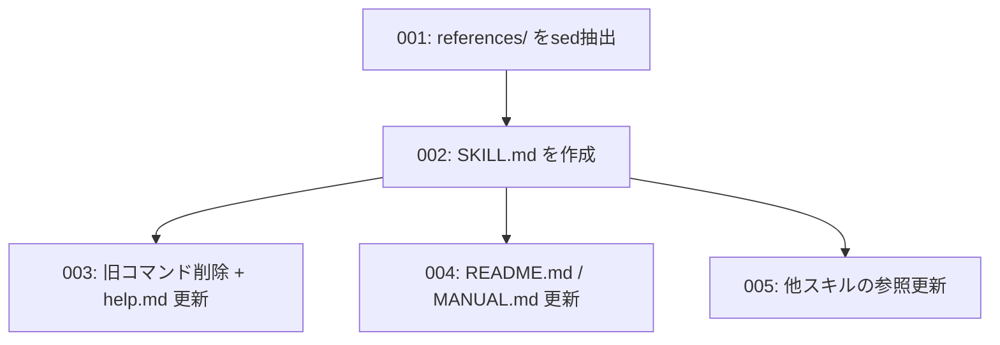

# Plan: rev-docs

## Requirements Summary

`commands/` に取り残された旧世代コマンド4本（`rev-tasks.md` / `rev-design.md` / `rev-requirements.md` / `rev-specs.md`、計1,731行）を、単一スキル `skills/rev-docs/` に統合する。

統合の理由:

1. **単体で成立しない** — 各コマンドの「前提条件」に他コマンドの事前実行が書かれており、事実上4本が連続実行される前提の設計になっている
2. **要件名の分割が毎回ブレる** — コードベースを機能単位に分解して `{要件名}` を決める処理が4本すべてに独立して存在する
3. **ドキュメント間の矛盾** — MANUAL.md:984 の推奨順序は `tasks → design → specs → requirements` だが、`commands/rev-specs.md:15` の前提条件は「rev-requirements 実行済み」。順序が逆に書かれている
4. **死んだ記述** — 4本すべてに `claude code rev-tasks --path ./backend` のような実在しないCLIの実行例が含まれる

### 決定事項

| 論点 | 決定 |
|---|---|
| フェーズ順序 | `tasks → design → requirements → specs`。受け入れ基準（requirements）が先にあってこそテスト仕様が導出できるため。MANUAL.md:984 を誤りとして修正する |
| テストコード生成 | 廃止。仕様書（test-specs.md / test-cases.md）のみ出力し、実コードの追加は dev-plan → dev-loop に任せる |
| 部分実行 | 不要。常に全4フェーズ通し実行 |
| 旧コマンド | 削除。エイリアスは残さない |
| 出力先パス | 変更しない（`docs/tasks/` `docs/design/` `docs/spec/`）。`skills/edgecase-analysis/SKILL.md:49` が `docs/spec/{$1}/requirements.md` を参照しているため |

## Design Overview

### 構造

`dcs-to-skills`（PR #8）と同じ方式を踏襲する。各旧コマンドは「実行内容（分析手順）＋巨大な出力フォーマット例」という規則的な構造を持つため、

- **フォーマット部分・分析手順**は `sed` で機械的に `references/` へ抽出する（再入力による内容劣化を防ぐ）
- **オーケストレーションのロジック**だけを skills 形式で書き下ろす

```
skills/rev-docs/
├── SKILL.md                        # 500行以内。Step 0〜5 のオーケストレーション
└── references/
    ├── phase1-tasks.md             # ← commands/rev-tasks.md:49-196, 216-221
    ├── phase2-design.md            # ← commands/rev-design.md:17-473, 492-497
    ├── phase3-requirements.md      # ← commands/rev-requirements.md:17-362, 385-391
    └── phase4-specs.md             # ← commands/rev-specs.md:17-591（テストコード生成部を除く）, 616-622
```

### ワークフロー

| Step | 内容 | 出力先 |
|---|---|---|
| 0 | **機能分割（1回のみ）** — コードベースを機能単位に分解し `{要件名}`（kebab-case, 50字以内）のリストを確定。以降の全フェーズがこれを共有する | — |
| 1 | tasks — 実装済み機能をタスクとして逆算 | `docs/tasks/{要件名}/overview.md`, `TASK-XXXX.md` |
| 2 | design — アーキテクチャ・データフロー・API・DB・型定義 | `docs/design/{要件名}/architecture.md` ほか4点 |
| 3 | requirements — EARS記法の要件・ユーザーストーリー・受入基準 | `docs/spec/{要件名}/requirements.md` ほか2点 |
| 4 | specs — テスト仕様書・テストケース一覧（**コードは生成しない**） | `docs/spec/{要件名}/test-specs.md`, `test-cases.md` |
| 5 | 最終レポート — 生成ファイル一覧・統計・信頼度の低い推定項目 | — |

機能数が多い場合はフェーズ×機能単位で Task サブエージェント（general-purpose）に委譲し、`references/` の該当テンプレートをプロンプトに埋め込む。サブエージェントには Task ツールを使わせない（`skills/dev-run/SKILL.md` の「サブエージェント制約」と同じ扱い）。

### 強制モードとの関係

`rev-docs` は `docs/` 配下にファイルを書くため、強制モードが有効なプロジェクトで保護ブランチ上から実行すると `hooks/guard-edit.mjs` に deny される。SKILL.md の `## ルール・制約` にその旨と worktree 内での実行を明記する。

## Task Dependency Graph



## Cross-Plan Dependencies

なし。`dcs-to-skills` で確立した構造変換パターンを踏襲するのみで、共有インターフェースは持たない。
